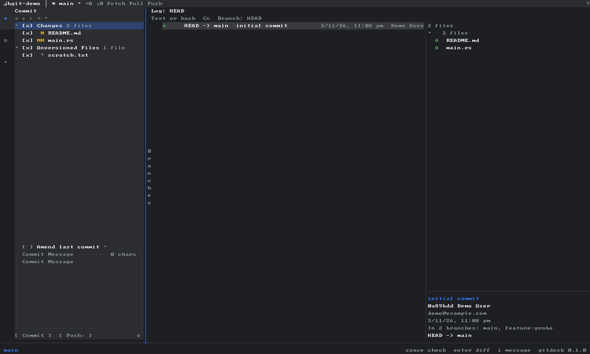
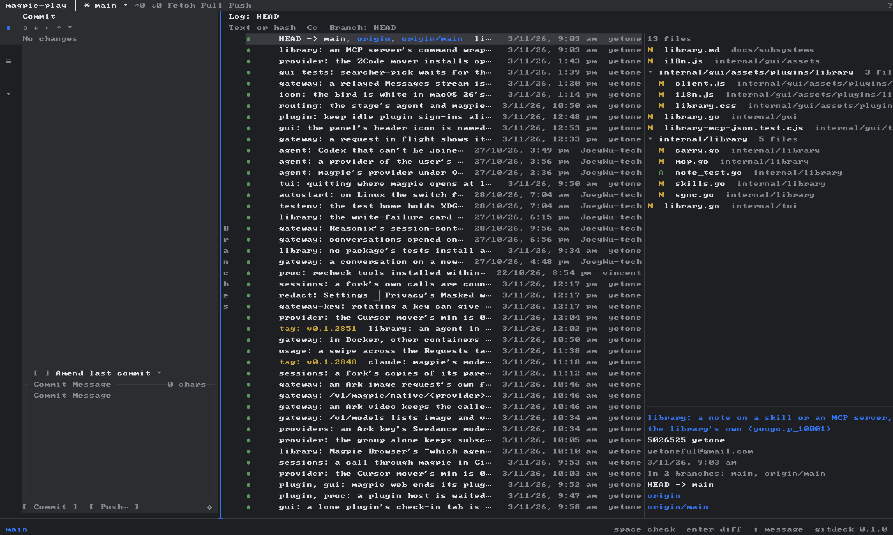
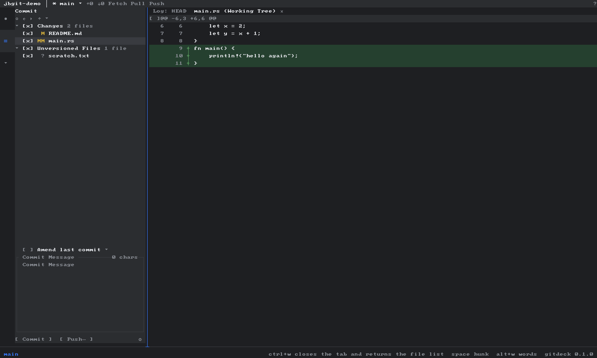

# gitdeck

**The JetBrains-style Git client that lives in your terminal.**

**English** · [简体中文](README.zh-CN.md)

Three panes, a commit graph, hunk-level commits, branches, remotes and conflict
resolution — the workflow you already have in your fingers, without leaving the
shell.

[](https://github.com/ktalg/gitdeck/actions/workflows/ci.yml)
[](#license)




## Why

`git status` tells you *what* changed. It does not tell you which commit a line
came from, which hunks belong together, or why a merge stopped halfway.

`gitdeck` puts the tool windows you know — **Changes**, **Log**, **Details** —
in front of you, and keeps your hands on the keyboard:

- stage by **file** or by **hunk**, commit exactly what you checked
- read the **graph** instead of `git log --graph --oneline`
- see `In N branches` and the committer, not just the author
- resolve conflicts with `alt+o` / `alt+t` / `alt+r`, then commit
- watch `MERGING` / `REBASING` and abort with a confirmation instead of a guess



## Install

```sh
cargo install --path crates/gitdeck-cli --locked   # from a checkout
# or
cargo build --release && ./target/release/gitdeck /path/to/repo
```

Requirements: `git` on `PATH` (gitdeck reads through the CLI and never
reimplements Git), a terminal of 80×24 or larger.

```sh
cd ~/some/repo && gitdeck
gitdeck --doctor          # what profile, theme and terminal size were detected
gitdeck --mouse-debug /tmp/mouse.log   # log raw mouse events when clicks misbehave
```

## The 60-second tour

| Key | What happens |
|---|---|
| `tab` / `shift+tab` | move focus: Changes → Log → Details |
| `j` `k` `↑` `↓` | move the selection; scroll a diff when its tab is active |
| `space` | toggle a checkbox, or the **hunk** under the cursor in a diff |
| `enter` | open the diff of a file; check out the selected branch |
| `i` | edit the commit message (from any pane) |
| `ctrl+enter` | commit the checked files or hunks |
| `alt+a` `alt+s` | amend, sign-off |
| `alt+m` `alt+n` `alt+shift+d` | merge, create, delete a branch |
| `alt+o` `alt+t` `alt+r` | accept ours / theirs / mark resolved |
| `alt+d` `alt+i` | discard a file's changes, ignore an untracked path |
| `alt+x` `alt+u` | abort / continue an interrupted merge or rebase |
| `p` `f` `ctrl+b` | pull, fetch, branch filter |
| `alt+w` `alt+z` | word-level highlight, soft wrap |
| `/` `?` | filter the log, list every binding |
| `ctrl+q` | quit (asks first if you have a draft message) |

`?` inside the app reads the same registry as `gitdeck --help`, so the two can
never drift apart.

## Stage four lines out of forty

The reason this exists: `git add -p` is a conversation, and sometimes you want a
checklist. Open the diff, `j`/`k` to a `@@` header, hit `space`, watch `[x]`
appear — commit only that.



`gitdeck` builds the patch from the index bytes and commits through a temporary
index, so CRLF files, tabs and mixed hunks survive the round trip, and a file
you did not check cannot sneak into the commit.

## What it is not

Deliberately out of scope for 1.0, tracked honestly:

- interactive rebase and a rebase word list
- cherry-pick / revert / reset menus
- a three-way merge editor (conflicts are resolved by side, not by hand)
- stash / shelf
- side-by-side diff, line-level staging, hunk splitting
- blame, file history, multiple repositories, tag management, submodules

Shelf, regex log filters and multi-tab layouts were visible in early builds and
have been removed rather than left as buttons that do nothing.

## Terminal compatibility

| Environment | Profile |
|---|---|
| `COLORTERM=truecolor`, iTerm2, WezTerm, ghostty, VS Code, Terminal.app | `rich` |
| `TERM=*256color`, `screen` | `standard` |
| `NO_COLOR`, `TERM=dumb`/`vt100`/`ansi`/`linux`, piped output | `basic` (pure ASCII) |

Use `GITDECK_CAPS=rich|standard|basic` or `--caps` to override.
Alignment, borders and the graph adapt to the profile — `basic` never emits a
non-ASCII glyph.

## Performance

The Log is virtualised and the details queries are debounced until the selection
settles, so scrolling a 10k-commit repository does not spawn a `git` process per
keystroke. First paint of a 6,000-commit repository is under a second.

## Development

```sh
just verify        # guard, fmt, clippy, unit, suite, real-PTY e2e, screenshot gate
just clean-verify  # clone the commit into a scratch dir and verify there
just probe steps.txt
```

Tests run against a sandboxed environment (`CARGO_HOME`, `TMPDIR`, XDG dirs and
`GIT_CONFIG_GLOBAL` all redirected inside the checkout), and the e2e suite drives
the real binary through a pseudo terminal — keyboard **and** mouse.

## Credits

The tool-window layout and the keyboard-first flow are shamelessly borrowed from
the way JetBrains does Git in its IDEs, because muscle memory is a feature. The
graph drawing, the diff renderer and the hunk staging are our own, written
against the terminal rather than ported from anywhere.

If you want the whole IDE, use the whole IDE. If you want the Git part while
your editor is open and your terminal is faster — this is for you.

## License

Dual licensed under either of [Apache-2.0](LICENSE-APACHE) or
[MIT](LICENSE-MIT), at your option.
