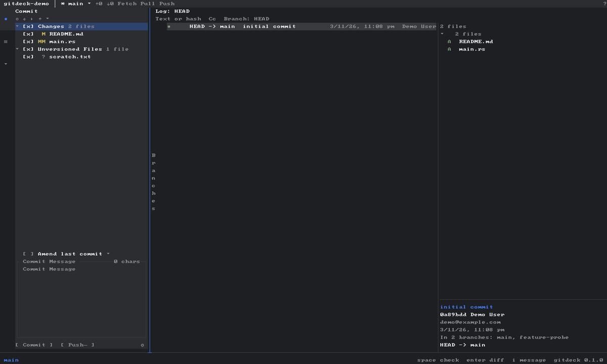
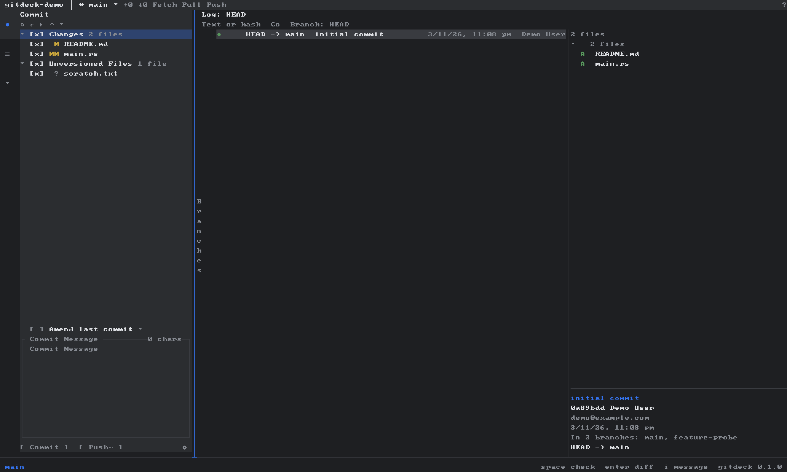
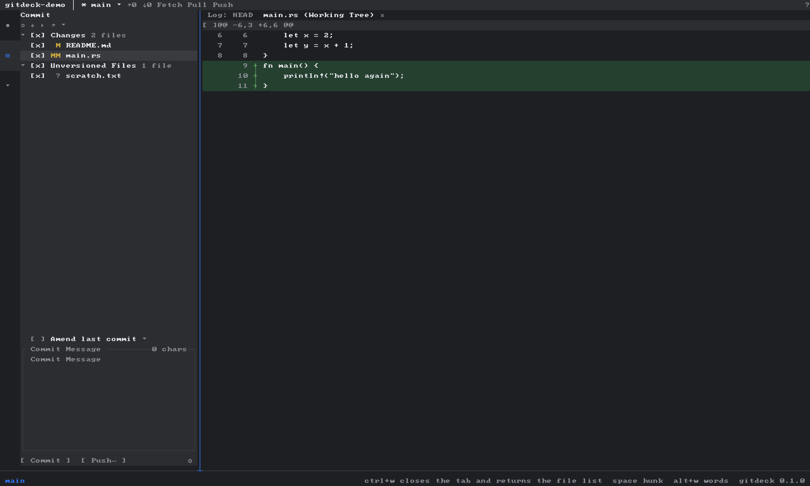

# gitdeck

**终端里的 Git 客户端，用你熟悉的那几个面板。**

[](https://github.com/ktalg/gitdeck/actions/workflows/ci.yml)
[](#许可证)



`git status` 会告诉你改了什么，但不会告诉你某一行来自哪个提交、哪些 hunk 该放进同一次提交，
也不会解释一次 merge 为什么停在半路。

gitdeck 把变更、历史、提交详情并排放进终端，全程用键盘操作。读写都走 `git` 命令，仓库行为
和你在命令行里看到的一致，不会多出任何东西。

[English](README.md) · **简体中文**

## 安装

```sh
cargo install --path crates/gitdeck-cli --locked
```

或者自己构建：

```sh
cargo build --release
./target/release/gitdeck ~/some/repo
```

需要 `PATH` 上有 `git`，终端不小于 80×24。

```sh
gitdeck --doctor                      # 能力档位、主题、终端尺寸
gitdeck --mouse-debug /tmp/mouse.log  # 记录原始鼠标事件，排查点击问题
```

## 能做什么

- **按 hunk 暂存。** 打开 diff，停在 `@@` 行按 `space`，勾上的才会进提交。
- **有图可看。** 分支、tag、合并线，一万条提交也能顺畅滚动。
- **变更自己会说话。** `MM`、` D`、`A `，索引区与工作区状态分两列，冲突时直接标出来。
- **分支能直接用。** 切换、新建、删除、合并，都在同一个列表里。
- **远程不用查手册。** Push、Fetch，Pull 支持 fast-forward / merge / rebase。
- **中断状态看得见。** `MERGING`、`REBASING`，可中止可继续，破坏性操作前先问一次。
- **diff 值得读。** 词级高亮、软折行、双行号，横向滚动到行尾就停住。



## 按键

| 按键 | 作用 |
|---|---|
| `tab` / `shift+tab` | 在 Changes、Log、Details 之间切换焦点 |
| `j` `k` `↑` `↓` | 移动选中项，或滚动已打开的 diff |
| `space` | 切换复选框，或光标所在的 hunk |
| `enter` | 打开文件 diff，或切换到选中分支 |
| `i` | 编辑提交消息 |
| `ctrl+enter` | 提交勾选的文件或 hunk |
| `alt+a` `alt+s` | Amend、sign-off |
| `alt+m` `alt+n` `alt+shift+d` | 合并、新建、删除分支 |
| `alt+o` `alt+t` `alt+r` | 采用我方、采用对方、标记已解决 |
| `alt+d` `alt+i` | 丢弃改动、忽略未跟踪文件 |
| `alt+x` `alt+u` | 中止或继续 merge / rebase |
| `p` `f` `ctrl+b` | Pull、Fetch、分支过滤 |
| `alt+w` `alt+z` | 词级高亮、软折行 |
| `/` `?` | 过滤日志、查看全部按键 |
| `ctrl+q` | 退出 |

`?` 与 `gitdeck --help` 输出自同一份按键表。

## 部分提交



`git add -p` 像是在对话，而有时候你只想要一张清单。

补丁取自索引字节，写入临时索引，CRLF、Tab 和相邻 hunk 都能原样保留；没勾的文件不会混进
这次提交。

## 当前版本没有

- 交互式 rebase、rebase 词表
- cherry-pick、revert、reset
- 三方合并编辑器
- stash
- 并排 diff、行级暂存、hunk 拆分
- blame、文件历史、多仓库、tag 管理、子模块

## 终端

| 环境 | 档位 |
|---|---|
| `COLORTERM=truecolor`、iTerm2、WezTerm、ghostty、VS Code、Terminal.app | `rich` |
| `TERM=*256color`、`screen` | `standard` |
| `NO_COLOR`、`TERM=dumb` / `vt100` / `ansi` / `linux`、输出被管道接管 | `basic` |

`basic` 只输出 ASCII。可以用 `GITDECK_CAPS` 或 `--caps` 覆盖。

## 性能

日志采用虚拟滚动，提交详情在选中项稳定后才查询，不随每次按键发起进程。六千条提交的仓库
首屏不到一秒。

## 开发

```sh
just verify        # fmt、clippy、单测、套件、真终端 e2e、截图门禁
just clean-verify  # 克隆当前提交到临时目录，在那里完整跑一遍
just probe steps.txt
```

测试在沙箱里运行：`CARGO_HOME`、`TMPDIR`、XDG 目录和 `GIT_CONFIG_GLOBAL` 都指向仓库内。
e2e 通过伪终端驱动真实二进制，键盘和鼠标都覆盖。

## 致谢

面板布局和键盘操作流借自 JetBrains 的 Git 窗口——肌肉记忆也是一种功能。提交图、diff 渲染
和 hunk 暂存是对着终端写的，不是对着别人的代码写的。

## 许可证

Apache-2.0 或 MIT，任选其一。
